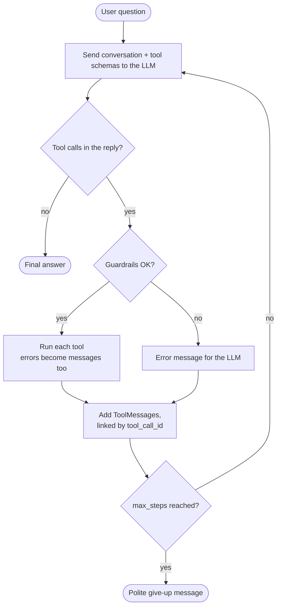

# 💸 Bill Buddy

A chat assistant that splits restaurant bills, calculates tips and converts currencies, built on a **tool-calling agent loop written from scratch** (no `create_agent`, no `AgentExecutor`).

Ask in plain language, in English or Spanish. Bill Buddy picks the right tools, chains them (tip → split → convert) and does every calculation in code with exact cents.

It also powers a **group-trip expense backend** ([Trip mode](#trip-mode-the-backend-for-a-group-trip-app)): tell it *"I paid the taxi, 45 dollars, for Ana and me"* and it proposes an expense card that a person confirms, then works out who owes whom.

> 🇪🇸 [Resumen en español abajo](#-resumen-en-español)


## What it can do

Real output, running locally with Ollama (`qwen3:8b`):

```text
You: Ana had pasta for 18, Luis had steak for 32, and we shared a 24 dollar bottle of wine. Add 15% tip. How much does each pay?
  🔧 split_itemized(tip_percent=15, items=[{"amount": 18, "person": "Ana"}, {"amount": 32, "person": "Luis"}], shared_amount=24)
     → {"per_person": {"Ana": {"own_items": 18.0, "shared_part": 12.0, "tax": 0.0, "tip": 4.5, "pays": 34.5}, ...
Ana pays $34.50 and Luis pays $50.60.

You: Convert 50 euros to Mexican pesos and 50 euros to Colombian pesos
  🔧 convert_currency(amount=50, from_currency="EUR", to_currency="MXN")
  🔧 convert_currency(amount=50, from_currency="EUR", to_currency="COP")
50 euros is equivalent to:
- 1,038.71 Mexican Pesos (MXN)
- 180,937.58 Colombian Pesos (COP)
```

| Tool | What it does |
|---|---|
| `calculate_tip` | Tip and total for a bill |
| `split_evenly` | Equal shares that **always add up to the exact total** (100 / 3 → 33.34 + 33.33 + 33.33) |
| `split_itemized` | Everyone pays what they ordered, plus an equal part of shared items, plus tax and tip **in proportion to what they consumed** |
| `convert_currency` | Today's exchange rate for 160+ currencies (USD, EUR, MXN, COP, ARS, CLP...) |

## The agent loop, from scratch

Frameworks hide the most important part of an agent. [`bill_buddy/agent.py`](bill_buddy/agent.py) writes it out in about 60 lines:



```python
for _ in range(self.max_steps):
    reply = self.model.invoke(self.messages)          # 1. ask the LLM
    self.messages.append(reply)
    if not reply.tool_calls:
        return message_text(reply)                    # 2. no tools -> final answer
    for call in reply.tool_calls:                     # 3. run EVERY requested tool
        result = self.run_tool(call["name"], call["args"])
        self.messages.append(ToolMessage(json.dumps(result), tool_call_id=call["id"]))
                                                      # 4. loop: the LLM reads the results
```

### Guardrails: rules in code, not just in the prompt

The prompt says *"if the user only says 'pesos', ask which country"*. In testing, `qwen3:8b` ignored that and assumed Mexican pesos every time. So the rule is now checked **in code** ([`guardrails.py`](bill_buddy/guardrails.py)) before `convert_currency` runs: an ambiguous peso conversion is blocked, and the model is told to ask. That's what the demo GIF shows. Guardrails work the same with any model, big or small.

## Trip mode: the backend for a group-trip app

The chat is fun, but the real use case is a trip with friends: lots of small expenses, two currencies, and a messy "who owes whom" at the end. Trip mode is the backend for a mobile app (Expo app coming next) where **the agent is the input method**:

```text
"I paid the taxi, 45 dollars, for Ana and me"
        │  POST /trips/1/chat
        ▼
  Trip agent ── propose_expense(...) ──► DRAFT card: Taxi · $45 (≈ 40.36 €) · paid by Laura · Laura, Ana
        │                                             │
        ▼                                             ▼  the person taps ✓
  "Here's the taxi card, please confirm it"     POST /expenses/2/confirm
                                                      │
                                                      ▼
                                     Balances + settle-up: "Ana pays Laura 20.18 EUR"
```

**Design rules:**
- **The AI suggests, people decide.** The agent can only create *drafts*. It has no tool to confirm, edit or delete. Balances only count confirmed expenses, so the AI can never move money on its own.
- **Numbers come from people.** A guardrail blocks any amount or tip the user never said. In testing, *"Paid lunch"* made the model invent "25 EUR + 10% tip". Now it asks *"How much was lunch?"*.
- **Fresh data every time.** Expenses change in the app between messages, so the agent must re-read balances for every question instead of answering from memory (the model did that in testing).
- **USD and EUR.** Each trip has a main currency. An expense in the other currency keeps its original amount, the exchange rate of that day, and the converted amount.
- **Settle-up in at most n−1 transfers.** It uses the greedy "biggest debtor pays biggest creditor" method ([`settle.py`](bill_buddy/settle.py)). The true minimum number of transfers is NP-hard in general. Tested on random trips: every balance always reaches zero.

| Endpoint | What it does |
|---|---|
| `POST /trips` | Create a trip: name, currency (USD/EUR), members |
| `GET /trips/{id}` | Everything a trip screen needs: members, expenses, drafts, balances |
| `POST /trips/{id}/chat` | Talk to the agent → `reply` + new `drafts` + the tool `steps` |
| `POST /trips/{id}/expenses` | Manual entry (the classic form), confirmed right away |
| `POST /expenses/{id}/confirm` · `DELETE /expenses/{id}` | Accept or discard a card |
| `GET /trips/{id}/balances` | Net balance per person and the transfers that settle the trip |

```bash
uvicorn bill_buddy.api:app --reload
# open http://localhost:8000/docs to try every endpoint in the browser
```

Data lives in a local SQLite file (`BILL_BUDDY_DB`, default `bill_buddy.db`).

## Getting started

**Requirements:** Python 3.10+ and [Ollama](https://ollama.com) (free, no API key).

```bash
ollama pull qwen3:8b                      # a local model with tool calling (~5 GB)

git clone https://github.com/laulys/bill-buddy.git
cd bill-buddy
python3 -m venv .venv
source .venv/bin/activate                 # Windows: .venv\Scripts\activate
pip install -r requirements.txt
cp .env.example .env                      # works as-is with Ollama
```

```bash
python -m bill_buddy                                           # chat
python -m bill_buddy "How much should I tip on \$60 at 20%?"   # one question
python -m bill_buddy --quiet "Split 100 between 3"             # hide the tool calls
uvicorn bill_buddy.api:app --reload                            # trip-mode API on :8000
```

**Other providers:** set `LLM_PROVIDER=openai` and `OPENAI_API_KEY` in `.env` to use OpenAI. For IBM watsonx, run `pip install langchain-ibm` and fill in the `WATSONX_*` values.

## Running the tests

```bash
pip install -r requirements-dev.txt
pytest
```

110 tests, with no API key, no Ollama and no internet needed:
- **Money:** rounding, splits that never lose a cent, proportional tax and tip.
- **Currency:** a fake HTTP API, caching, network errors.
- **Guardrails:** 8 phrasings of "pesos", and amounts or tips the user never said.
- **Agent loop:** a scripted fake LLM covers multi-step chains, parallel calls, unknown tools, invalid arguments, broken JSON, `max_steps`, follow-up memory and rollback after a failure.
- **Trip mode:** settle-up on 25 random trips, balances that always add up to zero, currency conversion, and the full API flow: chat → draft → confirm → balances, plus 400/404/503 errors.

GitHub Actions runs them on every push.

## Improvements over the course lab

This project started as the guided lab *"Build Interactive LLM Agents with Tools"* from IBM Skills Network, which builds a calculator and tip agent by hand. I kept the from-scratch approach and fixed its limits:

| In the lab | In Bill Buddy |
|---|---|
| Runs only `tool_calls[0]` | Runs every tool call in a reply (parallel calls) |
| One round only: can't chain "tip, then split" | Loops until the answer is ready, up to `max_steps` |
| `TipAgent` crashes when the model answers without a tool | Returns the answer directly |
| Unknown tool or bad arguments raise exceptions | Become error messages the LLM can read and fix |
| The class reads global `tools` / `tool_map` | Tools are passed in, so the agent is reusable and testable |
| `int` amounts (no $60.50, no 12.5%) and float math | `Decimal` money, exact cents |
| No memory between questions | Keeps the conversation for follow-ups ("Colombian pesos") |
| Rules only in the prompt | Guardrails enforced in code |

## What I learned

- **What `create_agent` actually does:** a loop of *LLM → tool calls → ToolMessages → LLM*, with `tool_call_id` tying each result to its request.
- **Every failure should become a message.** An agent that crashes on a bad tool call can't recover; one that returns `{"error": ...}` usually fixes itself on the next step.
- **Prompts are suggestions; code is a rule.** Guardrails make critical behavior reliable even with a small local model.
- **Money needs `Decimal`** and a deliberate way to hand out leftover cents.
- **Design the AI's permissions like a product feature.** Drafts plus human confirmation turn a risky "AI handles your money" into a safe "AI fills the form for you".
- **Give the model ready-made facts.** When the balances tool returned raw numbers, the model summarized the transfers wrong. Returning ready-made sentences ("Marta pays Luis 97.27 EUR") fixed it.

## Credits

Based on the IBM Skills Network guided project *Build Interactive LLM Agents with Tools* (author: Joshua Zhou; contributors: Kunal Makwana and Karan Goswami). The code in this repository is my own. Exchange rates by [ExchangeRate-API](https://www.exchangerate-api.com).

---

## 🇪🇸 Resumen en español

**Bill Buddy** es un asistente para dividir cuentas entre amigos: calcula propinas, reparte el total en partes iguales o según lo que pidió cada uno, y convierte monedas con el tipo de cambio del día. Le escribes en español o inglés y él usa herramientas de Python para hacer cada cálculo con exactitud de centavos.

**Qué demuestra este proyecto:**
- Un **ciclo de agente programado desde cero**, sin `create_agent`, para entender qué hacen los frameworks por dentro.
- Llamadas a varias herramientas en cadena y en paralelo, con manejo de errores y límite de pasos.
- **Guardrails**: reglas importantes verificadas en código. Por ejemplo, si dices solo "pesos", te pregunta de qué país.
- Dinero con `Decimal`: las partes siempre suman el total exacto.
- **Modo viaje:** el backend de una app para gastos de viaje en grupo. Le dices *"pagué el taxi, 45 dólares, para Ana y para mí"* y el agente propone una tarjeta que una persona confirma. Al final calcula quién le debe a quién con pocas transferencias (como máximo, una menos que el número de personas). La IA nunca guarda nada sin tu confirmación ni inventa montos.
- 110 tests automatizados con un LLM simulado, e integración continua con GitHub Actions.

**Cómo usarlo:** sigue los pasos de [Getting started](#getting-started). Funciona gratis en tu computadora con Ollama.

Basado en el laboratorio guiado de IBM Skills Network, reimplementado y ampliado como proyecto independiente.
